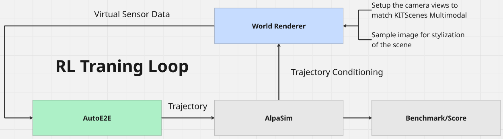

# Design Document: Closed-Loop Reinforcement Learning

## Document Metadata

| Field | Value |
|-------|-------|
| Status | Plugin and phase-1 reward implemented; RL loop and later phases proposed |
| Authors | Arseni10Lk |
| Date | 2026-08-06 (updated: 2026-10-18) |
| Related Issues | [#140](https://github.com/autowarefoundation/auto_e2e/issues/140), [#123](https://github.com/autowarefoundation/auto_e2e/issues/123) |
| Related PRs | [#177](https://github.com/autowarefoundation/auto_e2e/pull/177) |

## 1. Executive Summary

This document outlines the architecture for the **Stage-3 Closed-Loop Reinforcement Learning** pipeline of the AutoE2E policy model. It details the integration of the policy with the **AlpaSim** microservices simulation engine, with the **KITScenes** and **nuPlan** camera rigs and the world renderer (default: **NuRec (3D Gaussian Splatting)**). The first reward, already implemented, is the deviation from the recorded drive, bounded by the region where the reconstruction is reliable. As future work, the document proposes a dual-backend **SimAdapter** (latent vs. pixel rollouts) and a **RewardRegistry** with a multi-objective, faithfulness-gated reward against reward hacking. It closes with a domain-specific evaluation suite featuring service manoeuvres and counterfactual synthesis.

## 2. Motivation and problem statement

### 2.1 Original goal

During the meeting on July 8th 2026, the basic closed-loop training logic was established: 



### 2.2 Architecture

The closed-loop reinforcement learning framework consists of three primary components that form a continuous feedback cycle:

1. **AutoE2E (Policy Model)**
   The core driving model consumes virtual sensor data and outputs a predicted trajectory. During RL training, this acts as the active agent policy exploring the environment.

2. **AlpaSim (Simulation Engine)**
   AlpaSim consumes the trajectory generated by AutoE2E to update the physics and state of the ego vehicle. It is responsible for two downstream tasks:
   - **Reward Generation**: Its scoring module evaluates the safety and progress of the trajectory (collision, off-road, progress, deviation from the recording). These metrics and the recorded drive feed the reward (§6).
   - **Environment State**: It passes the updated kinematic state and trajectory conditioning to the rendering engine.

3. **World Renderer (Swappable)**
   The renderer synthesizes the next frame of the environment based on the updated vehicle state, for the camera rig the policy expects (see §5). The resulting virtual sensor data is then fed back into AutoE2E for the next time step, completing the loop.

## 3. Dataset Choice

The plugin itself is designed to support swappable datasets with varying camera configurations. Primarily, there are two candidates for reinforcement learning, which are the same datasets that were used for Reactive model training:

### 3.1 KITScenes Multimodal

The **KITScenes Multimodal** dataset is the primary foundation for closed-loop world generation and RL training.

**Justification:**
- **Sensor Fidelity**: Provides 81.8 MPix per frame across 9 global-shutter cameras. The images as delivered are 6 surround cameras at 3504×2272 (8.0 MPix each), 1 long-range front camera at 5856×3104 (18.2 MPix) and a rectified stereo pair at 2272×3488 (7.9 MPix each), which supports high-fidelity rendering.
- **Geographic Complexity**: Features irregular European road layouts (Karlsruhe, Frankfurt, Sindelfingen) to ensure robust policy training in non-grid environments.
- **RL Viability**: Designed explicitly for end-to-end driving and novel view synthesis, supplying the dense trajectory and visual data required to simulate realistic closed-loop consequences.


#### 3.1.1 The USDZ Reconstruction Challenge

The primary challenge introduced by coupling KITScenes with AlpaSim is a fundamental mismatch in required data formats. 

**The Disconnect:**
* **KITScenes Format**: The KITScenes documentation [1] lists the provided assets: raw sensor streams (images, LiDAR) and standard Lanelet2 HD maps. The dataset does **not** provide pre-compiled 3D scene representations.
* **AlpaSim Requirement**: AlpaSim's default NuRec renderer strictly requires the environment to be packaged into a `.usdz` container representing the reconstructed 3D Gaussian Splatting scene, recorded first-frame JPEGs, and exact camera calibrations. As stated in AlpaSim's TUTORIAL.md [2], *"Scenes in AlpaSim are USDZ artifacts built from real-world driving logs. The default NuRec renderer relies on ClipGT data packaged in the USDZ..."* Furthermore, the simulation lifecycle relies on this file type, starting precisely from the first valid `.usdz` timestamp (OPERATIONS.md [2]).

**The Resolution:**
To bridge this gap, a prerequisite data pipeline step is necessary: a **KITScenes-to-NCore (USDZ) conversion**. We must run an offline 3D Gaussian Splatting reconstruction pipeline on the raw KITScenes data to compile the required `.usdz` artifacts, allowing the NuRec renderer to successfully boot and supply multi-view rendering for our RL loop.

**Status (future work):** no KITScenes reconstruction exists yet. The reconstruction study in [#140](https://github.com/autowarefoundation/auto_e2e/issues/140) compared S³Gaussian, OmniRe, HUGSIM and their EMD-refined variants on one KITScenes scene. It found **HUGSIM + EMD** the best fit, because it models vehicles as separately controllable Gaussian objects, which AlpaSim can move. HUGSIM does not produce NuRec `.usdz` artifacts. A KITScenes world therefore either needs that conversion, or a HUGSIM-backed service behind AlpaSim's renderer endpoint (§4.1). The reconstructions and their rendering settings will live in a separate world repository; this repository keeps only the driver plugin.

### 3.2 nuPlan

**nuPlan v1.1** trained the released *nuPlan Epoch 5* checkpoint. Its eight cameras are 1920×1080 with lens distortion. Training undistorts six of them (`CAM_F0`, `L0`, `R0`, `L2`, `B0`, `R2`) to rectified pinhole images.

- **Rig:** the plugin's nuPlan profile comes from the camera table of a v1.1 log (mini split). All vehicles except veh-08 share the same intrinsics, and their extrinsics differ by at most 9 cm and 2.8°. The shipped profile is veh-35, which has the most logs and is the rig AlpaSim's Transfuser plugin also uses.
- **Worlds:** no NuRec reconstructions of nuPlan logs exist. Until they do, the nuPlan rig is tested by re-rendering NVIDIA NuRec sample scenes with the nuPlan cameras (§5).

## 4. World Renderer Choice

**NuRec (3D Gaussian Splatting)** combined with **CAT-K** (for reactive agent behavioral simulation) is the chosen world rendering pipeline.

**Justification based on [Issue #140](https://github.com/autowarefoundation/auto_e2e/issues/140) discussions:**
- **Synchronized Multi-View Generation**: 3DGS provides geometrically consistent and deterministic multiview rendering from a shared 3D representation, easily supporting KITScenes' complex 9-camera topology via explicit camera extrinsics/intrinsics. Rendering quality drops for viewpoints far from the recording cameras. This shows up both for a rig that differs from the one that recorded the scene, and for the ego leaving the recorded path.
- **Closed-Loop Latency**: Gaussian rasterization is highly performant and directly responds to ego trajectory changes, fulfilling the low-latency real-time requirements for RL training.
- **Handling Ghosting**: While 3DGS can exhibit ghosting artifacts when deviating far from the training path, this will be mitigated by terminating the RL session early (penalizing the agent) upon excessive path deviation.
- **Rejection of Alternatives**: Off-the-shelf diffusion models like NVIDIA Cosmos (OmniDreams) and Drive-WM were evaluated but ultimately rejected for the primary RL loop due to their prohibitive inference costs, lack of out-of-the-box synchronized multiview support, and difficulty in ensuring operational responsiveness to fine steering angles.

### 4.1 Why this is good news for our closed-loop training

AlpaSim supports NuRec out of the box. In fact, NuRec is designed as AlpaSim's **default** pluggable rendering backend, which eliminates the need for us to write custom boilerplate or bridging logic.

According to the official NVlabs/alpasim [2] documentation:
- **Native Integration**: The README.md [2] explicitly lists a "pluggable renderer service with default NuRec support" as a core feature.
- **Tutorial Default**: The Main Tutorial [2] states that standard execution uses the "NuRec-backed renderer" (`deploy=local`), validating its stability and readiness for immediate use.
- **Shared Endpoints**: Any alternative models (like OmniDreams) must adapt to the same `renderer` endpoint that NuRec natively owns (see VIDEO_MODEL.md [2]). 

Because of this, we can rely directly on AlpaSim's built-in hooks to stream our ego trajectories into NuRec and receive synchronized multiview observations with zero custom architectural overhead.

## 5. AutoE2E AlpaSim Plugin

The AlpaSim driver plugin lives in `Model/plugins/alpasim_driver/` and registers itself through the `alpasim.models` and `alpasim.configs` entry points.

### 5.1 Architecture & Components

- **`AutoE2EDriver`** subclasses AlpaSim's `BaseTrajectoryModel`. It rebuilds AutoE2E from the configuration saved in the checkpoint, runs it, and integrates the predicted controls with the training rollout (`integrate_controls_torch`). It returns the 64 waypoints as a `ModelPrediction` anchored at the timestamp of the newest camera frame.
- **`AlpasimStreamParser`** turns AlpaSim's camera frames and ego poses into the tensors of the packed training data.
- **Rig profiles** (`configs/calibration/*.json`) hold the camera calibration of each dataset rig. The driver picks the profile whose cameras match `driver.inference.use_cameras`.
- **YAML configuration** sets the rendered cameras, the 500 ms camera history (`context_length: 8`, `subsample_factor: 5`) and a 7 s forced-ground-truth warm-up.
  - `driver=autoe2e`: the KITScenes rig.
  - `driver=autoe2e_nuplan`: the nuPlan rig. AlpaSim's `extra_cameras` can only override cameras a scene already has, so this config renders the six rectified nuPlan cameras on six NVIDIA camera IDs. `nuplan_nurec.json` maps them back.

### 5.2 Data Contract

**Inputs** (from `PredictionInput`):
- **Cameras**: six cameras in model slot order (front, front-left, front-right, rear-left, rear, rear-right).
  - **KITScenes:** `camera_base_front_center`, `camera_ring_front_left`, `camera_ring_front_right`, `camera_ring_rear_left`, `camera_ring_rear`, `camera_ring_rear_right`; `camera_ring_front` is omitted.
  - **nuPlan:** `CAM_F0`, `CAM_L0`, `CAM_R0`, `CAM_L2`, `CAM_B0`, `CAM_R2`.
  - Each frame is squashed to a 512 px tile; the front camera also enters at 1024 px.
- **Camera history**: the seven previous frames, 500 ms apart, with projections into the current ego frame (BEVFormer T8).
- **Egomotion**: 64 rows of speed, acceleration, yaw rate and curvature before the current frame, derived from the ego poses. KITScenes divides yaw rate by `max(speed, 0.1)` (`data_parsing/kit_scenes/egomotion.py`). nuPlan zeroes curvature below 0.5 m/s and clips it to ±0.5 (`data_parsing/nuplan/packing.py`). Each rig profile carries its dataset's rule.
- **Map and route**: AlpaSim's model API passes neither to the driver, so the model receives `map_valid = route_valid = False` (the camera-only track). Route conditioning from AlpaSim's route is future work.

**Outputs** (`ModelPrediction`): 64 waypoint poses at 10 Hz in the rig frame (*X* forward, *Y* left), built from positions and headings with `ModelPrediction.from_planar`.

### 5.3 Current Limitations

- **No map or route:** AlpaSim's model API passes neither to the driver, so the model runs camera-only.
- **Rendering domain gap:** AutoE2E was trained on real images. NuRec renders show artifacts for viewpoints away from the recording cameras, for example the nuPlan rig in an NVIDIA scene, and on dynamic vehicles.
- **Worlds:** KITScenes and nuPlan reconstructions do not exist yet (§3).

## 6. Reward Design

### 6.1 Phase 1: Deviation from the Recorded Drive

As agreed during one of the working group meetings (more information in [#123](https://github.com/autowarefoundation/auto_e2e/issues/123) and [#177](https://github.com/autowarefoundation/auto_e2e/pull/177)), closed-loop RL starts from the imitation objective turned into a reward. This gives a simple, well-understood baseline. Two physical constraints also favor starting here:
1. **Raw Sensor Stream Availability:** Real-world datasets (such as KITScenes) provide high-resolution camera streams and Lanelet2 HD maps, but do not provide ground-truth 3D bounding box annotations for all dynamic agents at runtime.
2. **3DGS Novel View Degradation:** The NuRec environment is reconstructed from camera observations captured along the logged trajectory. Deviating beyond approximately 3.0 meters enters under-sampled regions of the 3D Gaussian Splatting representation, introducing visual ghosting artifacts that corrupt policy observation.

The **phase-1 reward** is scored once per AutoE2E decision. It is implemented as `GroundTruthDeviationReward` in `Model/plugins/alpasim_driver/alpasim_autoe2e/rewards.py`:

```python
R = w_track * R_track + R_bound
```

- **Tracking term ($R_{\text{track}}$):** the negative displacement between the plan and the recorded drive. Both are the 64 waypoints at the same timestamps, in the rig frame at decision time:
  $$R_{\text{track}} = - (\alpha \cdot \text{ADE} + \beta \cdot \text{FDE}), \quad \alpha = 1.0,\ \beta = 0.5$$
  Waypoints past the end of the recording are left out.
- **Renderer validity bound ($R_{\text{bound}}$):** once the **ego itself** is more than $d_{\max} = 3.0\,\text{m}$ from the recorded ego position, a terminal penalty of $-10$ is added and the decision is flagged `truncated`. The bound is a property of the renderer, not a driving preference ([#123](https://github.com/autowarefoundation/auto_e2e/issues/123), 23 September). It therefore does not share $w_{\text{track}}$, and it acts on where the cameras are rather than on where the plan ends. A plan that brakes for traffic can end far from the recording while the camera views stay reliable.

`tools/score_rollout.py` applies the reward to an AlpaSim `rollout.asl`. On the first closed-loop rollout (nuPlan Epoch 5, 3 decisions), it scored −0.79, −2.17 and −11.05. The last plan brakes and ends 13 m short of the recording, while the ego stayed within 2.3 cm of it, so nothing was truncated.

*(Note on Stationary-Ego Progress Incentive):* In Phase 1, the stationary-ego failure mode cannot occur. If the ego stops or under-progresses, the recorded drive keeps moving. ADE and FDE grow, and the ego soon falls more than 3 m behind the recorded position, which triggers the terminal penalty and truncation. The progress incentive is therefore carried by construction in Phase 1, rather than requiring the dedicated progress term of Phase 2 (§6.2.2).

**Future work within Phase 1:**
- **Wiring:** the reward returns `truncated`, but ending the episode is the RL environment's job. That environment, and the loop that collects rewards, do not exist yet (§7).
- **Threshold provenance:** the 3 m bound comes from [#140](https://github.com/autowarefoundation/auto_e2e/issues/140) and [#177](https://github.com/autowarefoundation/auto_e2e/pull/177) and has not been measured. Rendering quality (PSNR/LPIPS) against lateral offset from the recorded path would ground it and show whether it must be per scene.
- **Off-road term:** an off-road term against Lanelet2 drivable polygons was prototyped earlier in [#177](https://github.com/autowarefoundation/auto_e2e/pull/177). It needs a map, which AlpaSim does not pass to the driver, and AlpaSim already reports an `offroad` metric. It moves to Phase 2's safety term.

### 6.2 Phase 2 (Future Work): Multi-Objective Reward Formulation

Based on the [Issue #123](https://github.com/autowarefoundation/auto_e2e/issues/123) proposal for mature stage-3 closed-loop RL, once dynamic bounding box perception and counterfactual simulation modules are established, the reward function will expand to a non-redundant multi-objective registry. *Non-redundant* is the first design rule of [#123](https://github.com/autowarefoundation/auto_e2e/issues/123): every term must carry information the policy cannot already infer from its own inputs. A term computed only from what the policy observes can re-weight its preferences but cannot change its ranking of actions. Candidate sources are the world model's predicted consequences of an action, spatial structure the planner discards (the unpooled BEV, [#121](https://github.com/autowarefoundation/auto_e2e/issues/121)), and external ground truth such as HD-map conflict geometry.

```python
R = w_safe * R_safety          # collision / off-road / TTC violation (hard, handcrafted)
  + w_prog * R_progress        # route progress (binding term to prevent stalling)
  + w_comf * R_comfort         # jerk, lateral acceleration
  + w_reason * g * R_reason    # reasoning-shaped, GATED (faithfulness gate)
  - λ * D(π || π_IL)           # imitation anchor (regularization)
```

*(Note: Keeping Imitation Learning as a regularization term inside RL is directly motivated by **RAD** [3]).*

#### 6.2.1 The Faithfulness Gate (`g`)

A major risk in neural reward models is reward hacking, where the policy emits a reason that *matches* its action to farm rewards, even if that reason did not actually cause the action (a "plausible narrative", as warned in **LaViPlan** [4]).

To prevent this and enforce true reasoning-action consistency (**Alpamayo-R1** [5]), the `R_reason` term is multiplied by `g`, a **faithfulness gate**. `g` measures the causal coupling (via intervention delta). The reasoning-shaped reward contributes *only* when the reasoning is verifiably causal for the policy's trajectory. If `g` reads zero (indicating decoupled reasoning under forced-coupling calibration and structural redundancy checks), the term contributes nothing, falling back smoothly to the safety/progress baselines.

#### 6.2.2 Progress as a Safety Metric

In the one AlpaSim rollout of the imitation-only checkpoint reported in [#123](https://github.com/autowarefoundation/auto_e2e/issues/123) (one scene, setup in [#140](https://github.com/autowarefoundation/auto_e2e/issues/140)), the policy caused no collision and never left the lane, but it covered only 8.48 m of the 73.77 m recorded route and was rear-ended (`collision_rear` 1.00). Safety and compliance terms alone would score that policy as near-perfect while it barely drives. In Phase 2, `R_progress` is therefore treated as a safety term: under-progress is consistent with being rear-ended by traffic that an at-fault collision metric does not attribute to the ego. (Note that in Phase 1, stationary-ego stalling is already prevented by construction via $R_{\text{track}}$ and the renderer validity bound of §6.1).

## 7. Training Infrastructure (Future Work)

A photorealistic renderer in the closed RL loop is computationally expensive. To prevent the reward design and RL tuning phases from being bottlenecked by rendering latency, the proposed architecture introduces a dual-backend infrastructure.

### 7.1 Two-Tier Rollout Adapter (`SimAdapter`)

The `SimAdapter` will provide a unified interface for policy rollouts, abstracting away the underlying world model to support fast iteration:
- **Tier-L (Latent)**: Rollouts occur purely in the JEPA world-model latent space. Because there is no pixel rendering overhead, this tier is exceptionally fast and is used to sweep and tune reward variants across thousands of episodes. (Motivated by **MAPLE** [6], which proved the viability of latent-space multi-agent rollouts).
- **Tier-P (Pixel)**: Rollouts utilize the full generative simulator (AlpaSim + NuRec). This tier is reserved for final policy validation, generalization testing, and computing the definitive performance metrics.

### 7.2 The `RewardRegistry`

Following the established patterns for planners and temporal memory, reward terms will be implemented as decoupled plugins managed by a `RewardRegistry` (`handcrafted`, `irl`, `reasoning_shaped`, `faithfulness_gated`).

Each plugin conforms to a strict interface (`term(state, action, rollout, info) -> Tensor`) and must declare the inputs it consumes.

## 8. Evaluation Strategy (Future Work)

To thoroughly validate the RL policy, our proposed evaluation suite addresses specific shortcomings found in existing public benchmarks (e.g., NavSim, Bench2Drive).

### 8.1 Service Manoeuvres Taxonomy

Standard closed-loop benchmarks predominantly evaluate merges, overtakes, and intersections. However, as a robotaxi application, the policy must also excel at passenger interactions. Our planned task taxonomy explicitly introduces **Service Manoeuvres**:
- **Pull-over**
- **Pick-up**
- **Drop-off**

These tasks will be evaluated using domain-specific service metrics, such as stopping precision (distance to curb) and door-opening safety.

### 8.2 Counterfactual Synthesis (Addressing Optimistic Bias)

A known risk of training world models exclusively on safe expert data is the development of an "optimistic bias" (**AD-R1** [7]). Because the model has never observed a collision, it cannot reliably predict the consequences of catastrophic actions. A reward computed *inside* this generative model can therefore get hacked by "hallucinated success" (**WoVR** [8]), leading the RL agent to optimize against a flawed simulation.

To combat this, the planned evaluation suite will rely on **Counterfactual Synthesis**. By generating a curriculum of plausible collisions and off-road events (diverging from the expert log), we will force the world model to predict unsafe states. Measuring how accurately the model represents these failure modes is a strict prerequisite before gating any rollout-based reward.

## 9. References

1. KIT-MRT. "KITScenes Multimodal Dataset." https://kitscenes.com/multimodal/
2. NVIDIA. "AlpaSim: Open-Source Generative Microservices for Autonomous Driving." https://github.com/NVlabs/alpasim
3. "RAD: Training an End-to-End Driving Policy via Large-Scale 3DGS-based Reinforcement Learning." 2025. https://arxiv.org/abs/2502.13144
4. "LaViPlan: Language-Guided Visual Path Planning with RLVR." 2025. https://arxiv.org/abs/2507.12911
5. "Alpamayo-R1: Bridging Reasoning and Action Prediction for Generalizable Autonomous Driving in the Long Tail." 2025. https://arxiv.org/abs/2511.00088
6. "Latent Multi-Agent Play for End-to-End Autonomous Driving." (MAPLE) 2026. https://arxiv.org/abs/2605.14201
7. "AD-R1: Closed-Loop Reinforcement Learning for End-to-End Autonomous Driving with Impartial World Models." 2026. https://arxiv.org/abs/2511.20325
8. "WoVR: World Models as Reliable Simulators for Post-Training VLA Policies with RL." 2026. https://arxiv.org/abs/2602.13977
