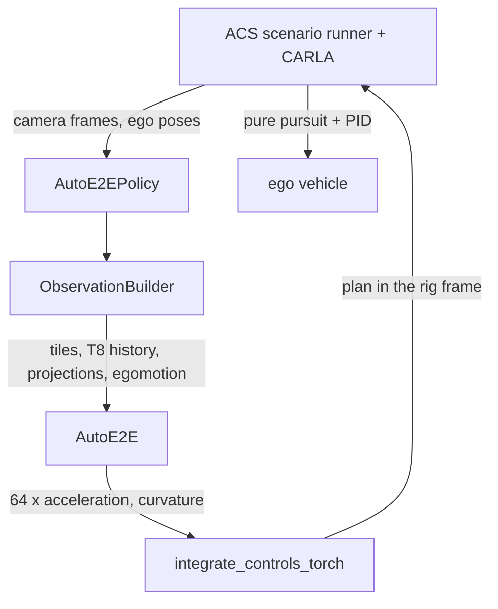

# AutoE2E CARLA Driver Plugin

This package lets the AutoE2E reactive policy drive the ego vehicle of an [autoware_carla_scenario](https://pypi.org/project/autoware-carla-scenario/) (ACS) run in CARLA. Use it to run closed-loop scenarios: cut-ins, junctions, adverse weather, and anything else ACS can script.

ACS hands its ego to a policy over AlpaSim's `egodriver` gRPC contract. [`carla-driver-interface`](https://pypi.org/project/carla-driver-interface/) is the policy side of that contract, and `AutoE2EPolicy` is a `BaseDriver` of it. It supports the same checkpoints as the [AlpaSim plugin](../alpasim_driver/README.md): the released reactive BEVFormer T8 checkpoints (`view_fusion_kwargs.architecture == "bevformer_v2_t8"`).

## How it works



- **`AutoE2EPolicy`** ([`policy.py`](./acs_autoe2e/policy.py)) rebuilds AutoE2E from the `config` in the checkpoint, the way the AlpaSim plugin does.
  - The predicted controls are integrated with the training rollout.
  - The plan is anchored at `t0`, the newest camera time, and re-expressed in the rig frame of the drive's time.
  - ACS tracks the plan with its trajectory follower.
- **`ObservationBuilder`** ([`observation.py`](./acs_autoe2e/observation.py)) builds the same tensors as the AlpaSim parser.
  - ACS streams every rendered frame and every tick's ego pose, so the frames 500 ms apart are picked from the stream (within 50 ms, as in training).
  - The egomotion history is 64 rows on a 10 Hz grid, by finite differences of the poses.
  - `map_context` and `route_mask` are zeros with closed validity gates, as under AlpaSim, so the model runs on its camera-only track.
- **Rig** ([`rig.py`](./acs_autoe2e/rig.py)): ACS declares every camera it renders: intrinsics, resolution, and the optical frame in the rig frame (rear axle, x forward, y left, z up).
  - The projections are built from those declarations, so they describe the images CARLA actually rendered.
  - The dataset profile (`nuplan` by default, from the AlpaSim plugin's `configs/calibration`) contributes only the camera slots, the dataset policy and the curvature rule.
- **F-theta cameras** ([`lens.py`](./acs_autoe2e/lens.py)): the Cosmos3 world model ([cosmos3-canvas](https://github.com/hakuturu583/cosmos3-canvas) through carla_canvas) generates NVIDIA's Hyperion cameras through F-theta lenses.
  - A dataset camera that is not declared as a pinhole is drawn as a virtual pinhole, at the dataset's mount, from the F-theta cameras that see it.
  - The model's projections are the virtual camera's, so they stay exact.

## Driver presets

ACS mounts each camera relative to the vehicle and renders ideal pinholes. [`tools/acs_preset.py`](./tools/acs_preset.py) writes the ACS `driver` preset that renders a dataset rig:

```bash
python tools/acs_preset.py nuplan > autoe2e_nuplan.yaml                                   # six nuPlan pinholes
python tools/acs_preset.py nuplan --cosmos-lenses lenses.jsonl > autoe2e_nuplan_cosmos.yaml  # Hyperion F-theta cameras
```

- **Pinhole preset:** each camera keeps the nuPlan mount and angular field of view. nuPlan's rectified pixels are not square, so the CARLA image keeps the native vertical field of view and is squashed to the model's square tiles, as in training.
- **Cosmos preset:** each Hyperion camera is mounted at the nuPlan camera it stands in for. The lenses are those `python -m cosmos3_canvas.camera <camera> --format json` prints.

The generated presets ship in the ACS package [`experiment/closed-loop-carla`](../../../experiment/closed-loop-carla), which registers them with the `scenario` CLI:

| Preset | Cameras |
| :--- | :--- |
| `driver=autoe2e_nuplan` | The six nuPlan v1.1 cameras, rendered by CARLA |
| `driver=autoe2e_nuplan_cosmos` | Six Hyperion cameras generated by Cosmos3 (`canvas.config=<cosmos3 canvas.yaml>`) |
| `driver=autoe2e_nuplan_cosmos7` | The seven Hyperion cameras of FlashDreams' `--views 7` set, generated by Cosmos3 |

Every preset declares `warmup_s: 7.0`. ACS runs the ego onto its spawn pose for 7 s before the scenario starts, so the 6.4 s egomotion history and the 3.5 s camera history are real when AutoE2E takes over. The policy's output is ignored during the warm-up.

## Running a scenario

The policy runs in the AutoE2E environment (Python 3.12) and the scenario runner in the ACS environment. They talk over gRPC.

```bash
# 1. The policy, in the AutoE2E environment
pip install carla-driver-interface
PYTHONPATH=Model/plugins/carla_driver carla-driver-interface serve \
    --policy acs_autoe2e.policy:AutoE2EPolicy \
    --policy-arg checkpoint_path=/path/to/checkpoint.pt --port 50051

# 2. The scenario, in the ACS environment
cd experiment/closed-loop-carla && uv sync
uv run scenario scenario=cut_in/left map=town10hd_opt \
    driver=autoe2e_nuplan driver.address=localhost:50051
```

Notes:

- `checkpoint_path=MOCK` drives straight ahead without a model, to test the plumbing. `UNTRAINED` builds the release architecture with random weights.
- Outside this repository, point `AUTOE2E_MODEL_ROOT` at a copy of `Model/`.
- With Cosmos3 cameras, install the `cosmos` extra (`uv sync --extra cosmos`) and pass `canvas.config=<cosmos3 canvas.yaml>`.
- `AUTOE2E_ACS_DEBUG_DIR=<dir>` writes, for every `AUTOE2E_ACS_DEBUG_EVERY`-th prediction (default 10), these files:
  - the camera tiles the model was given;
  - the raw frames ACS sent;
  - the egomotion, the projections and the plan.

## Status

With the nuPlan Epoch 5 checkpoint, the ego leaves its lane within 2 s of the takeover on the `cut_in/left` scenario. The plan bends right, and the bend grows each step. It does this with CARLA's cameras and with Cosmos3's.

This is the ego-motion feedback described for AlpaSim in [`experiment/closed-loop/RESULTS.md`](../../../experiment/closed-loop/RESULTS.md):

- With the yaw rate and curvature of the egomotion history set to zero, the same inputs give a plan within a few decimetres of straight at 3 s.
- With that change, the scenario passes.

The integration checks that point at the model rather than at this plugin:

- The ego's yaw rate sign matches the dataset's (left positive, rad/s).
- ACS's follower tracks the plan.
- The projections equal the calibration's.
- Mirroring the inputs (images, slots, projections, egomotion) mirrors the plan.
