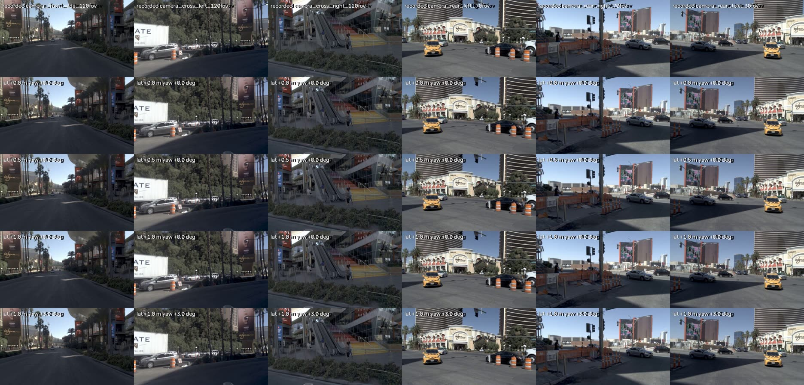
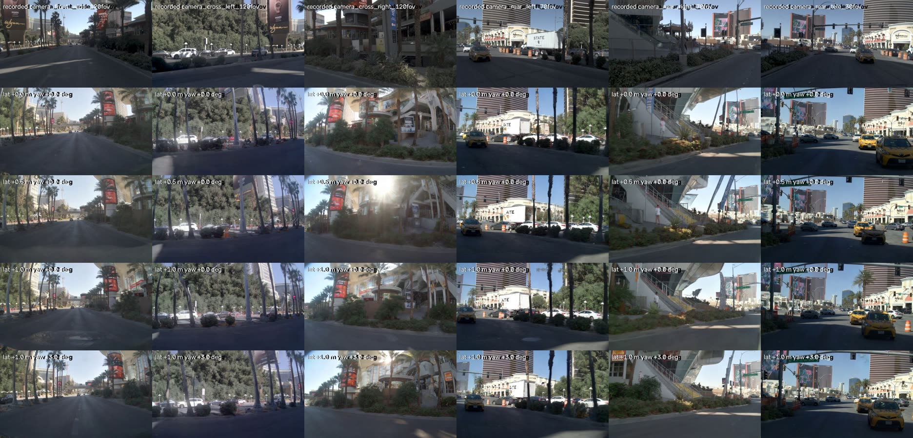
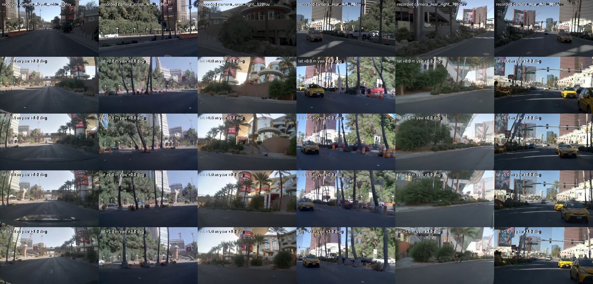
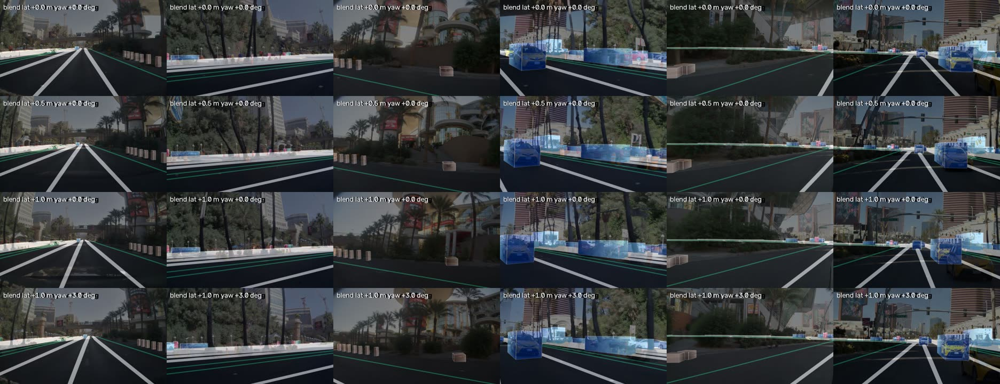

# Results: Cosmos3-Nano-Sim-Auto on one nuPlan scene

Checked 2026-11-01 against Cosmos3-Nano-Sim-Auto revision `e289a50` and cosmos-framework `55f0554`.

## 1. Model facts

From the model card (https://huggingface.co/nvidia/Cosmos3-Nano-Sim-Auto), the framework docs
(`docs/inference_sim_auto.md`) and the Hugging Face file listing.

| Item | Value |
| --- | --- |
| Inputs | One WSM control video per camera (lane lines, road edges, crosswalks, signs, lights, object boxes rendered along the ego path), one caption per camera, optional first RGB frame per camera, optional HD-map range images for LiDAR |
| Outputs | 1 to 11 synchronized camera videos at 480p (832x480) or 720p, 10-30 fps, optional 128-beam LiDAR |
| Ego motion | Not a direct input; it enters only through the WSM controls rendered along the trajectory |
| Generation | Causal, chunk by chunk with a rolling KV cache, 4 fixed denoising steps (distilled from Transfer-Auto) |
| License | OpenMDW 1.1, commercial and non-commercial use; weights are not gated |
| Size | 16B parameters; 32.4 GB of weights (transformer 30.3 GB) plus the Wan2.2 VAE fetched on first use |
| Supported hardware | Card: H100/H20/H200 and B200/B300/GB200/GB300. Code: rolling inference requires FlashAttention-4 on sm90 or sm100/sm103 |

The hardware requirement is enforced in `cosmos_framework/model/generator/mot/maskless_attention.py`.
On a g7e (RTX PRO 6000 Blackwell, sm120) the run stops with "it needs FlashAttention-4 on Hopper
(sm90) or Blackwell (sm100/sm103), got sm120". L4 and L40S are sm89. No g-family instance can run it,
so the shared L40S dev box was never an option. All numbers below come from one p5.4xlarge (1x H100 80GB).

## 2. Speed and memory on one H100

NVIDIA's shared sample, RGB only, 480p, 201 frames (the card's benchmark length), seed 0.
Generation time is from the first "Rolling replay" log line to the last line; wall time adds about
25 s of model loading.

| Views | Generation [s] | Frames/s (all views together) | Model card, H100 | Peak GPU memory [GB] |
| ---: | ---: | ---: | ---: | ---: |
| 1 | 24 | 8.4 | 10.2 | 39.3 |
| 6 | 115 | 1.75 | not listed | 70.6 |
| 7 | 133 | 1.51 | 1.4 | 80.6 |

On the nuPlan clips (6 views, 480p, 121 frames = 4 s at 30 fps) each clip took 64-70 s and the
peak was 73.1 GB. Six views at 720p ran out of memory on the 80 GB H100 (twice, the second time
with expandable segments), so 720p needs more than one GPU with this CLI. That matters because
AutoE2E reads the front camera at 1024 px, wider than the 832 px that fits.

## 3. The nuPlan experiment

nuPlan v1.1 mini, log `2021.05.12.22.28.35_veh-35_00620_01164` (Las Vegas Strip, in front of the
Wynn), 4 s from the first straight segment at 5 m/s or more. The same window was converted four
times with the ego displaced to its left: 0, 0.5 m, 1.0 m, and 1.0 m with 3° yaw, each ramping in
over 2 s. All four share the recorded first frame of every camera and the same captions. See
[README.md](./README.md) for how nuPlan was mapped to the renderer.

Rows: recording, then the four clips. Columns: front, front-left, front-right, rear-left,
rear-right, rear. The recording is 10 Hz, so the nearest recorded frame is shown.

At 0 s:

At 2 s:

At 4 s:

Each clip at 4 s, 50% WSM control and 50% generated RGB:

### Fidelity to the recording

PSNR [dB] of the unshifted clip against the undistorted recording, resized to 832x480.

| Camera | 0 s | 2 s | 4 s |
| --- | ---: | ---: | ---: |
| front | 21.2 | 14.2 | 12.7 |
| front-left | 20.2 | 14.5 | 13.2 |
| front-right | 23.0 | 11.4 | 10.4 |
| rear-left | 16.7 | 12.9 | 12.3 |
| rear-right | 17.3 | 13.0 | 13.4 |
| rear | 19.3 | 14.0 | 12.8 |

At 0 s the frame is the conditioning image after the VAE round trip and the resize. By 2 s the
front views already show buildings and a pedestrian bridge that are not in the recording. The rear
views keep the recorded objects longer (the white truck, the taxis, the Wynn buildings).

### Response to the ego shift

Horizontal shift [px] of the lower image half on the last frame, against the unshifted clip, by
phase correlation. "Control" is what the shift asks for; "generated" is what the model produced.

| Clip | Front control / generated | Rear-left control / generated | Rear control / generated |
| --- | ---: | ---: | ---: |
| 0.5 m | 6.9 / 0.9 | -28.1 / 0.5 | -10.2 / -7.8 |
| 1.0 m | 40.1 / -0.2 | -58.3 / -87.5 | -20.4 / -55.8 |
| 1.0 m, 3° | 75.1 / 0.1 | -19.2 / 0.0 | 12.4 / -29.9 |

The controls move as expected. The generated pairs give no consistent shift: most values are near 0
and the rest do not track the controls. Phase correlation needs the two images to show the same
scene, and they do not. Last-frame PSNR shows why:

| Clip | Mean PSNR vs the unshifted clip [dB] | Mean PSNR vs the same clip with seed 1 [dB] |
| --- | ---: | ---: |
| unshifted | - | 15.3 |
| 0.5 m | 15.6 | 15.5 |
| 1.0 m | 14.8 | 15.5 |
| 1.0 m, 3° | 14.5 | 15.9 |

Changing only the seed changes the picture as much as moving the ego by 1 m. Within each clip the
generation does follow its own controls: in the blends the taxi sits in its box and the curb follows
the road-edge line. But the scenery around them is re-imagined per clip, so a shifted clip is not the
recorded scene seen from 1 m to the left.

## 4. Assessment

### As lateral-recovery data (instead of warping, `feat/lateral-recovery-kl`)

Not as-is. Recovery data needs the recorded scene from a displaced viewpoint, so that the only
difference the policy can learn from is the offset. Here the scene drifts from the recording within
2 s, and the shift's effect is no larger than seed noise. Labels would stay consistent with the lanes
(they come from the same map as the controls), but the images would teach the model a different
scene. The view warping of Bojarski et al. [1] and ChauffeurNet's perturbations [2] keep the real
scene and accept local artifacts; comma's KL loss [3] targets exactly those artifacts. Further
points against it today:

- Cost: one 4 s, 6-view clip at 480p takes about 70 s on an H100 (about $0.07 at the $3.65/h Spot
  price seen in us-east-2). 10,000 clips would be about 190 H100-hours, and only on sm90/sm100 GPUs.
- Resolution: 480p on one GPU, below the 1024 px front input.
- Rig: nuPlan's six 64° cameras are mapped onto NVIDIA's reference keys (120°, 70°, 30°). NVIDIA
  says custom rigs degrade quality and recommends post-training Transfer-Auto on the target rig and
  distilling it again.
- Pipeline: generated views would be a new labels or pack layer, needing a design doc and
  integration into `wf_autoe2e`. Warping lives after the DataLoader and changes no contract.

It could become useful if the generation stayed anchored to the recording, for example with more
conditioning frames than one or after post-training on our rigs. That was not tested here.

### As the AlpaSim renderer (instead of NuRec)

Design/reinforcement_learning.md §4 rejected video models for three reasons. Against each:

- Inference cost: still prohibitive. Six views run at 1.75 frames/s on an H100, against a model
  clock of 30 frames/s. A 20 s AlpaSim rollout (600 frames) would take about 6 minutes of generation
  alone. NVIDIA's own figure for real time is 7 views on 32 GB200 GPUs at 23.2 FPS at 832x480
  (technical report [4], Table 14). On our L40S dev box, AlpaSim with NuRec runs the whole 20 s rollout in about 17 minutes,
  of which at most about 2.7 minutes are not the AutoE2E driver (experiment/closed-loop/RESULTS.md:
  85 minutes for 5 rollouts, 130 driver calls of 6.6 s each); NuRec's own time is not logged.
- Synchronized multi-view: addressed. One request generates all six cameras together, and objects
  stay consistent across neighbouring views in our grids (the truck and taxis in rear-left and rear).
- Steering responsiveness: partly. The controls follow the ego exactly and the generation follows
  the controls, but the rest of the scene does not stay fixed when the ego moves, so the policy would
  see a different world after each correction. The released checkpoint "generates 12-frame chunks"
  (technical report, Table 14), 0.4 s at 30 fps, so a steering change cannot show up sooner than the
  next chunk.

NuRec also runs on the L40S, while Sim-Auto needs an H100 or newer. The §4 decision stands.

## 5. Limitations

One scene, one log, seeds 0 and 1, 480p. Captions were written by hand from the first frames. The
map conversion is simplified (no paint classes, no traffic lights or signs, flat ground). PSNR and
phase correlation are crude; no learned perceptual metric was run.

## 6. Reproducibility and cost

`run.sh` was run a second time from an empty directory on the same instance with the committed
scripts: about 20 minutes from setup to comparison, exit code 0. PSNR values matched the first run
within 0.01 dB. The phase-correlation shifts of the generated pairs did not: for the 0.5 m clip the
front-left value was -126.2 px in one run and -27.7 px in the other, which fits the reading above that
the generated pairs share no common image content to correlate.

Instances, both Spot, up to 2026-11-01 12:16 UTC, priced at the Spot rate seen at launch (the bill
may differ):

| Instance | Use | Hours | Rate [USD/h] | Cost [USD] |
| --- | --- | ---: | ---: | ---: |
| g7e.2xlarge, us-east-1b | sm120 check, converter and renderer debugging | 2.2 | 2.99 | 6.5 |
| p5.4xlarge, us-east-2b | all generation | 1.5 | 3.65 | 5.4 |

## References

1. M. Bojarski et al., "End to End Learning for Self-Driving Cars," arXiv:1604.07316, 2016.
2. M. Bansal, A. Krizhevsky, A. Ogale, "ChauffeurNet: Learning to Drive by Imitating the Best and
   Synthesizing the Worst," arXiv:1812.03079, 2018.
3. comma.ai, "End-to-end lateral planning," https://blog.comma.ai/end-to-end-lateral-planning/
4. NVIDIA, "Cosmos Simulation technical report," 2026-10-21,
   https://research.nvidia.com/labs/cosmos-lab/cosmos-simulation/technical-report.pdf
5. B. Kerbl et al., "3D Gaussian Splatting for Real-Time Radiance Field Rendering," SIGGRAPH 2023.
